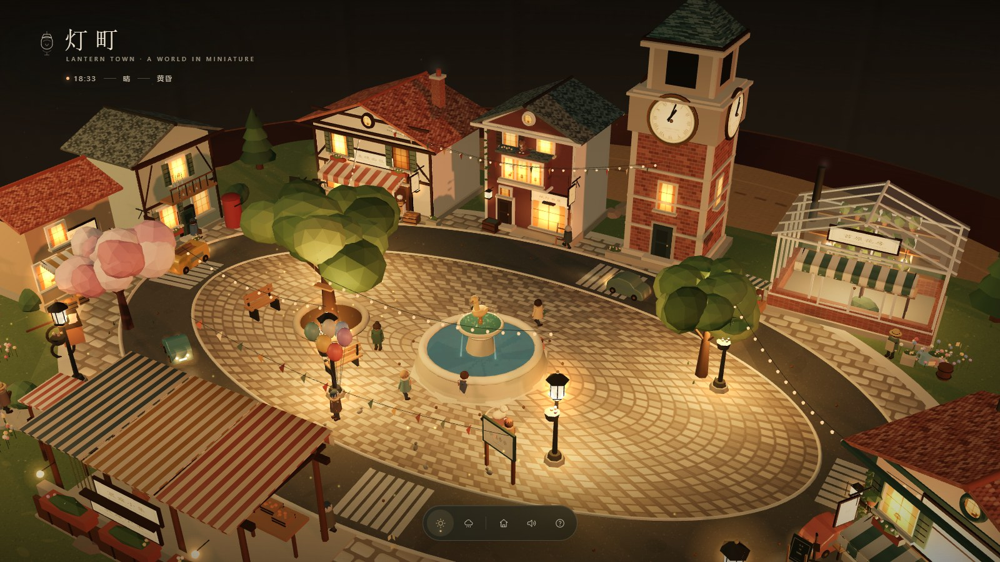
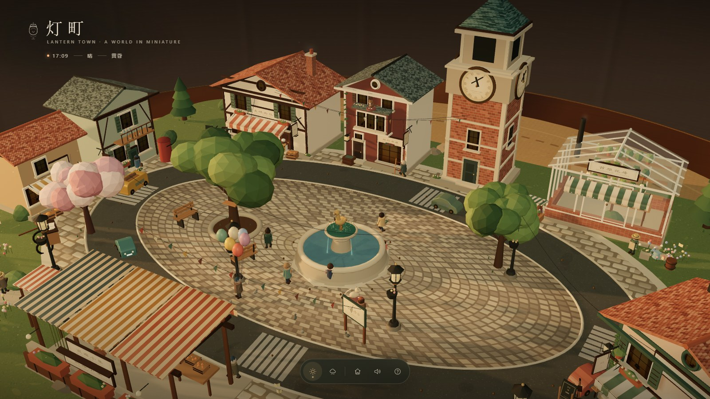
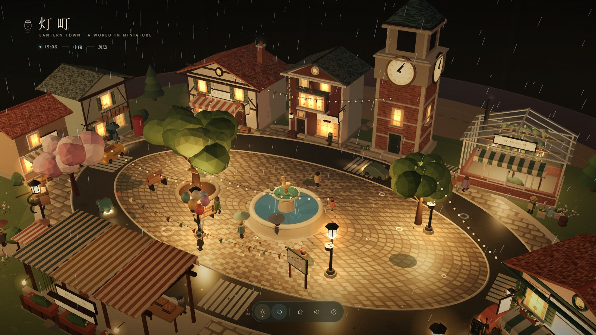
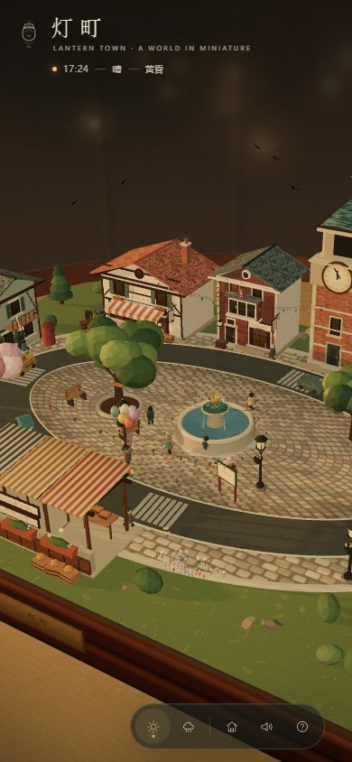

# 灯町 · Lantern Town

> 一座放在桌面上的 3D 微缩小镇。  
> 白天有人出门，傍晚窗灯次第亮起，下雨时，大家都往屋檐下躲。



**灯町**是一份完全运行在浏览器里的互动微缩模型：没有外部贴图、没有构建步骤、没有后端。所有场景、角色、声音和 Three.js 都收在一个 `index.html` 里。双击即可离线打开，也可以直接发布到 GitHub Pages。

## 它会自己生活

- **一天会过去。** 午后、金色时刻、黄昏、入夜、清晨，光线和房间的颜色都会慢慢变化。
- **傍晚点灯。** 入夜前后，镇上三十多扇窗会错落地亮起来；街灯、店招、串灯和路灯也陆续醒来。钟楼会在 18:00 和 6:00 敲钟。
- **天气会自己来。** 进入后大约 50 秒会迎来第一场雨，也可以在底栏随时呼风唤雨。有人撑伞，有人快步躲进面包房、书屋、咖啡店、花房和集市的屋檐下；雨停后各自回到街上。
- **镇上有人。** 22 位居民各有作息和路线：面包师、书店主人、花房姑娘、邮差、小孩、夜归人，以及在喷泉边弹吉他的街头乐手、卖气球的爷爷。入夜后街灯和萤火虫接管小镇。
- **细节在呼吸。** 汽车沿环路穿行，猫在屋顶伸懒腰，鸭子在池塘里绕圈，鸽子在广场上啄食。烟囱会冒烟，咖啡会冒热气，晾衣绳、树冠、风铃和气球都在轻轻动。

## 可以点一点

喷泉会收下一枚硬币并回你一个愿望；钟楼会打钟；面包房的烟囱会喷一团烟；书屋里会飞起纸页；花房会落下一阵花瓣；路灯会亮起来；汽车会按喇叭；树会抖下一阵叶子；窗子可以一扇扇点亮；猫会跳起来，鸭子会嘎嘎叫，行人会朝你挥手，气球爷爷会和你说话。

把鼠标停在一处，它会告诉你可以点什么。双击任何一样东西，镜头会轻轻落到它面前。

| 午后 | 小雨 |
| --- | --- |
|  |  |

<p align="center">
  
</p>

## 操作

| 操作 | 作用 |
| --- | --- |
| 按住拖动 | 环绕小镇转动视角 |
| 滚轮 / 双指捏合 | 靠近或拉远 |
| 双击 | 聚焦到某样东西 |
| 单击 | 与喷泉、窗、人、动物、车、店铺互动 |
| 底部太阳 | 暂停 / 正常 / 快进时间 |
| 底部云朵 | 呼风唤雨 / 收雨 |
| 底部房子 | 回到远景 |
| 底部喇叭 | 开关声音 |
| 底部问号 | 打开这张说明 |

键盘：`空格` 暂停 / 继续 · `T` 时间快慢 · `R` 下雨 · `M` 静音 · `H` 说明 · `0` 回到远景 · `Esc` 关闭说明。

声音在进入小镇后的第一次点击才会启动（浏览器对自动播放的限制），首次进入后默认打开；可以随时在底栏静音。

## 本地运行

最简单的方式：双击 `index.html`。

如果浏览器对 `file://` 的本地资源限制较多，可以在本目录运行一个静态服务：

```bash
python -m http.server 8080
```

然后打开 <http://localhost:8080/>。

## 部署到 GitHub Pages

1. 将本目录**全部内容**上传到一个 GitHub 仓库的根目录（`index.html` 必须在根目录）。
2. 进入仓库 **Settings → Pages → Build and deployment**。
3. Source 选择 **Deploy from a branch**，Branch 选择 `main`，目录选择 `/(root)`，保存。
4. 等待 GitHub 构建，地址通常是：

```text
https://<用户名>.github.io/<仓库名>/
```

仓库自带的 `.nojekyll` 会让 GitHub Pages 跳过 Jekyll 处理，不需要额外配置。详细说明见 [UPLOAD.md](UPLOAD.md)。

## 文件结构

```text
.
├── index.html              # 完整的单文件 3D 小镇（含 Three.js）
├── README.md
├── UPLOAD.md               # 给上传者的操作说明
├── THIRD_PARTY_NOTICES.md  # Three.js 的 MIT 署名
├── .nojekyll
├── .gitignore
└── screenshots/
    ├── dusk.jpg
    ├── day.jpg
    ├── rain.jpg
    └── mobile.jpg
```

## 技术说明

- Three.js r158，作为 UMD bundle 内联在 `index.html` 中。
- 纯 WebGL / Canvas / Web Audio，无图片资源请求，无后端。
- 场景、地形、建筑、人物、植物、纹理、招牌和粒子都由代码生成。
- 支持鼠标和触屏；竖屏会自动使用更广的镜头。
- 推荐使用较新的 Chrome、Edge 或 Safari，并开启 WebGL。桌面端全屏观看的效果最好。

## 署名与许可

除 Three.js 外，场景、角色、贴图、代码与文字均为本项目创作，未使用外部美术素材。Three.js 的 MIT 许可见 [THIRD_PARTY_NOTICES.md](THIRD_PARTY_NOTICES.md)。

本仓库没有默认附带开源许可证；是否公开授权、采用何种许可证，请由作者决定。
